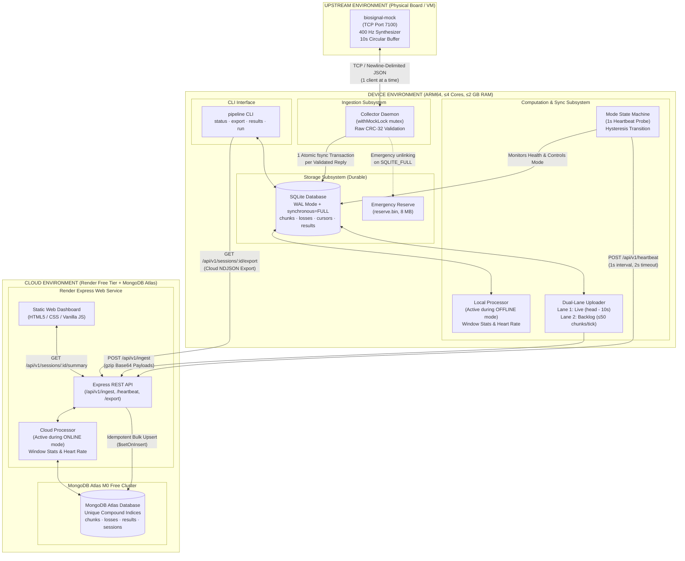
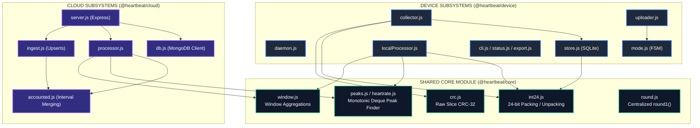
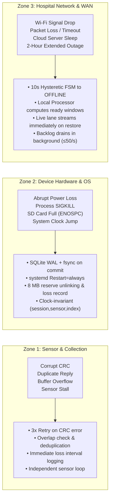

# Heartbeat Pipeline: Architecture Specifications & Mermaid Diagrams

This document outlines the system topology, boundary isolation, and internal components of the **Never Lose a Heartbeat** data pipeline.

---

## 1. System Topology & Physical Boundaries



---

## 2. Component Layering & Separation of Concerns



---

## 3. Data Schema & Persistence Mapping

```mermaid
erDiagram
    %% SQLite Schema
    SESSIONS_SQLITE {
        string id PK
        string first_seen
        int ended
    }
    CURSORS_SQLITE {
        string session PK
        int sensor PK
        int next_index
        int ended
    }
    CHUNKS_SQLITE {
        string session PK
        int sensor PK
        int first_index PK
        int count
        blob payload
        string crc32
    }
    LOSSES_SQLITE {
        string session PK
        int sensor PK
        int from_index PK
        int to_index
        string reason PK
        string source
    }
    RESULTS_SQLITE {
        string session PK
        int window PK
        string mode PK
        string body
    }

    %% MongoDB Atlas Schema
    CHUNKS_MONGO {
        string session PK
        int sensor PK
        int first_index PK
        int count
        binData payload
        string crc32
        date received_at
    }
    LOSSES_MONGO {
        string session PK
        int sensor PK
        int from_index PK
        int to_index
        string reason PK
        date received_at
    }
    RESULTS_MONGO {
        string session PK
        int window PK
        string mode PK
        float heart_rate
        float magnitude
        object mean
        object min
        object max
        date processed_at
    }

    SESSIONS_SQLITE ||--o{ CHUNKS_SQLITE : contains
    SESSIONS_SQLITE ||--o{ LOSSES_SQLITE : tracks
    SESSIONS_SQLITE ||--o{ RESULTS_SQLITE : generates

    CHUNKS_SQLITE ..|> CHUNKS_MONGO : "Idempotent Replicate"
    LOSSES_SQLITE ..|> LOSSES_MONGO : "Idempotent Replicate"
    RESULTS_SQLITE ..|> RESULTS_MONGO : "Consistent Result Format"
```

---

## 4. Failure Isolation & Fault Containment Zones


