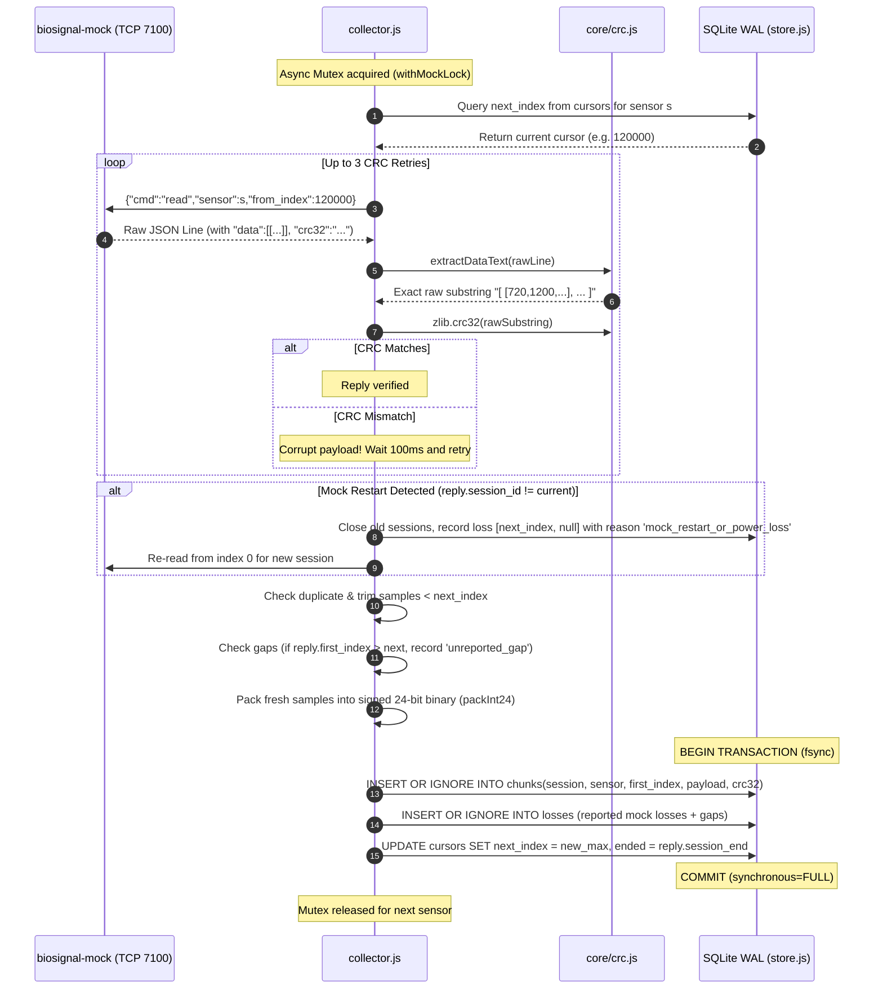
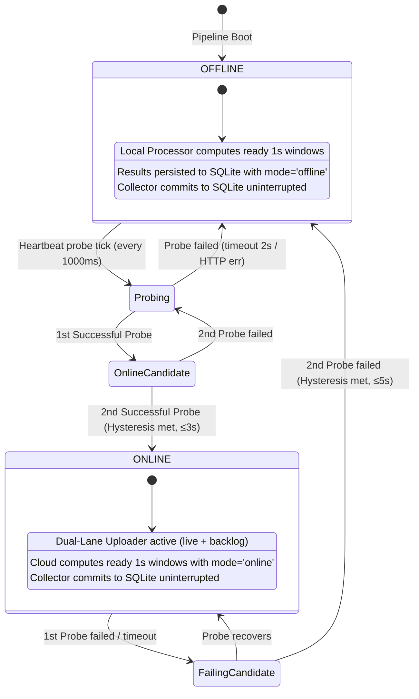
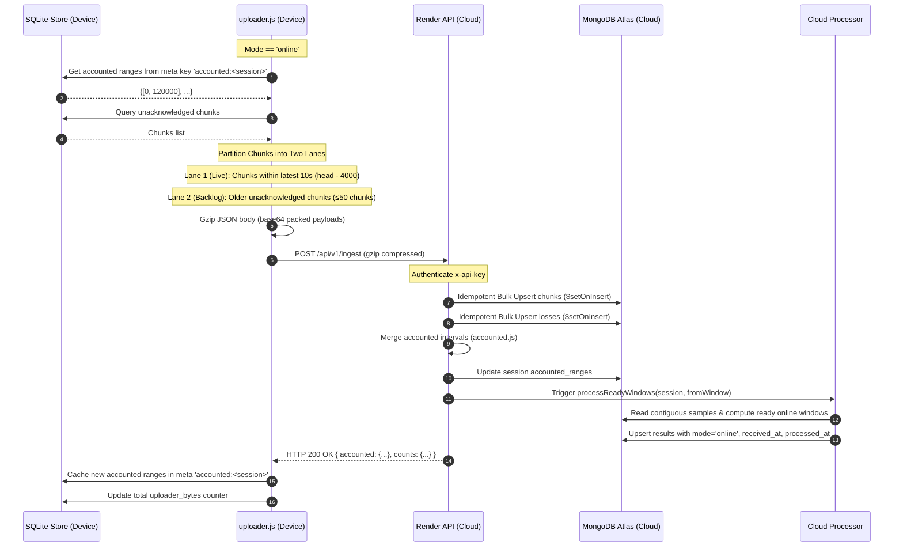
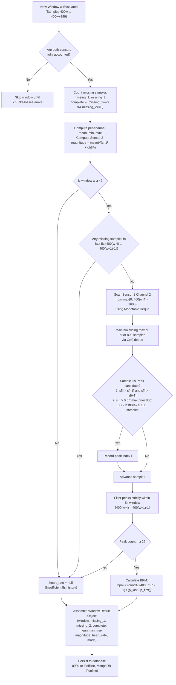
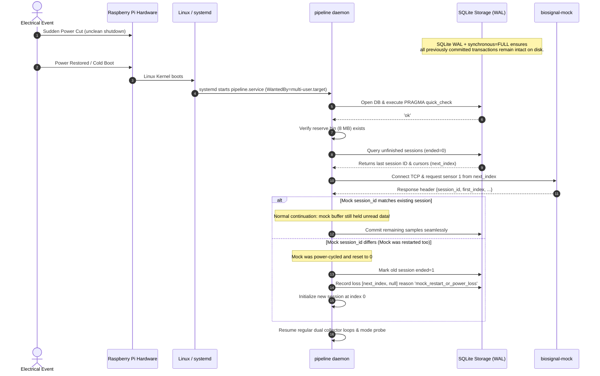
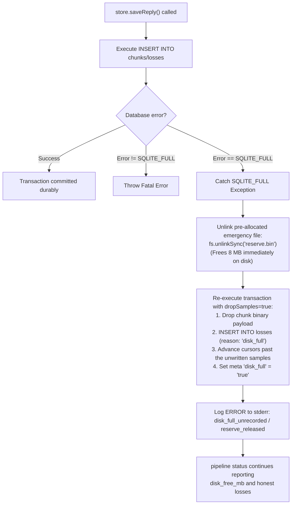

# Heartbeat Pipeline: Workflow Specifications & Mermaid Diagrams

This document details the core runtime workflows, sequence interactions, and state machines governing the **Never Lose a Heartbeat** pipeline.

---

## 1. Collector Ingestion & Raw CRC-32 Validation Sequence

This sequence ensures zero-data-loss ingestion from the single-client `biosignal-mock` with raw CRC verification and atomic SQLite persistence.

---

## 2. Mode State Machine & Network Transition (FSM)

The device daemon operates an independent heartbeat loop evaluating network reachability against the Render cloud service.

---

## 3. Dual-Lane Upload & Accounted Synchronization

The uploader simultaneously fulfills real-time streaming (<5s delay) and large backlog catch-up (<15 min for 2-hour outage) without violating MongoDB Atlas rate limits.

---

## 4. Signal Processing & Sliding Deque Peak Tracking

This workflow executes on both edge and cloud to generate identical 1-second window outputs and ECG heart rate calculations.

---

## 5. Sudden Power Cut & Reboot Recovery Workflow

---

## 6. Storage Full (ENOSPC) Emergency Mitigation

